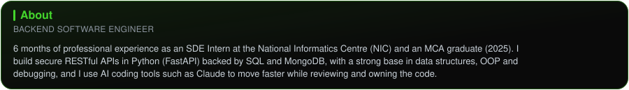
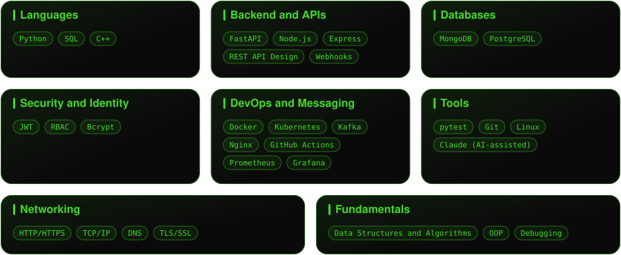
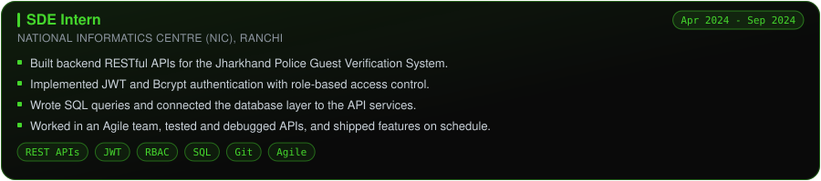
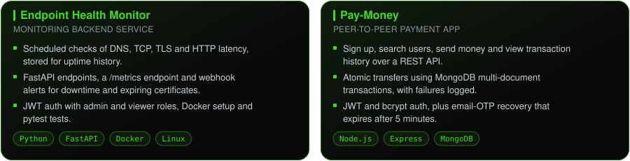
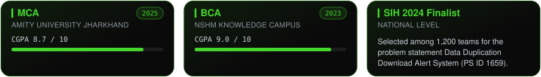

<div align="center">


<br/>

[](mailto:ababhishek3005@gmail.com)
[](https://linkedin.com/in/abhishek-k-0181b5229/)
[](https://leetcode.com/u/BLITzZzZzZz/)


</div>

<br/>

<div align="center">



<br/><br/>



<br/><br/>



<br/><br/>



<br/><br/>



</div>

<br/>

<div align="center">

## GitHub Activity


<br/>


<br/>


<br/>

<picture>
  <source media="(prefers-color-scheme: dark)" srcset="https://raw.githubusercontent.com/BLITzZ0/BLITzZ0/output/github-contribution-grid-snake-dark.svg" />
  <source media="(prefers-color-scheme: light)" srcset="https://raw.githubusercontent.com/BLITzZ0/BLITzZ0/output/github-contribution-grid-snake.svg" />
  
</picture>

</div>

<br/>

<div align="center">

### Weekly Coding Activity

<!--START_SECTION:waka-->

```txt
From: 24 October 2026 - To: 31 October 2026

Total Time: 2 hrs 48 mins

Other    18 hrs 12 mins        █████████████████████▓░░░   86.62 %
Python   2 hrs 15 mins         ██▓░░░░░░░░░░░░░░░░░░░░░░   10.74 %
Text     33 mins               ▓░░░░░░░░░░░░░░░░░░░░░░░░   02.64 %
```

<!--END_SECTION:waka-->

</div>

<br/>

<div align="center">

## Contact

Open to backend engineering roles. If you are hiring for backend, API or<br/>
distributed systems work, I would be glad to hear from you.

<br/>

[](mailto:ababhishek3005@gmail.com)
[](https://linkedin.com/in/abhishek-k-0181b5229/)
[](https://github.com/BLITzZ0)

<br/>


</div>
